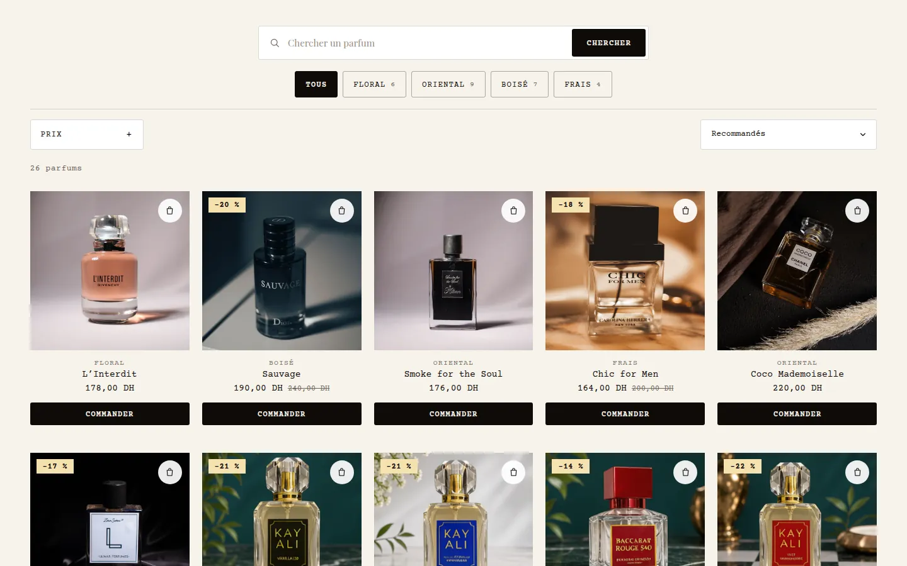
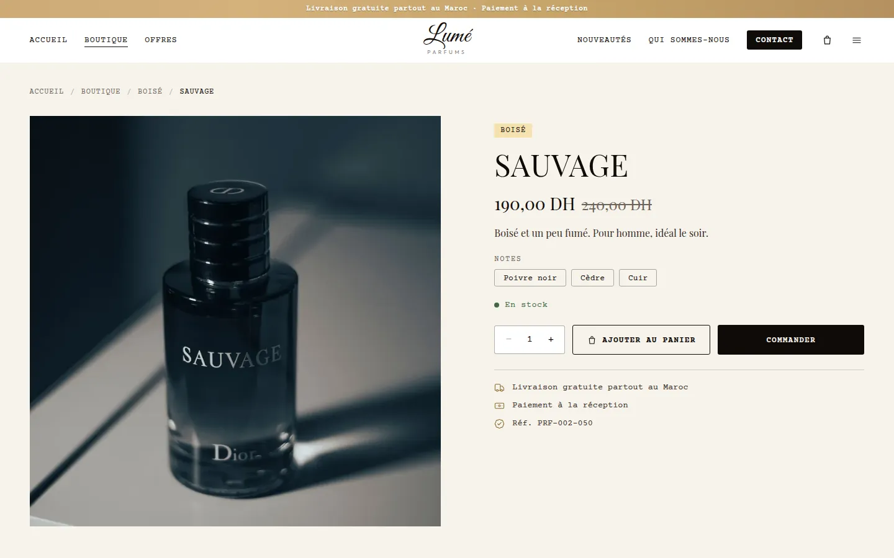
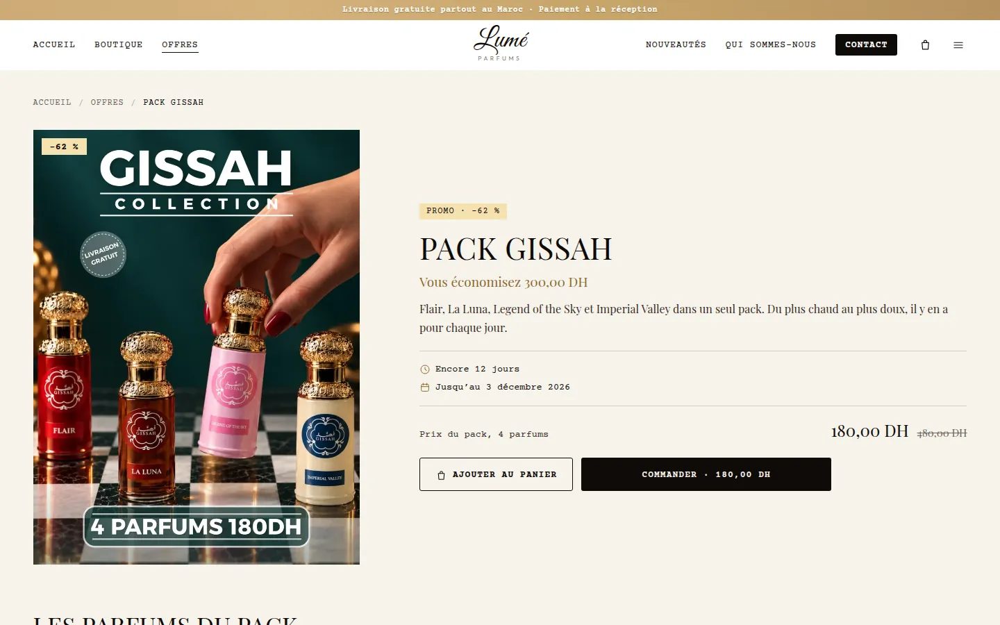
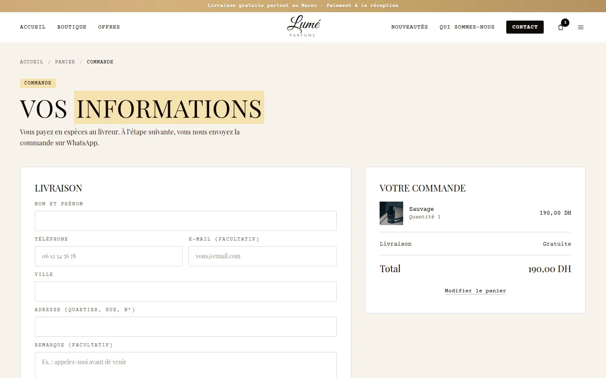
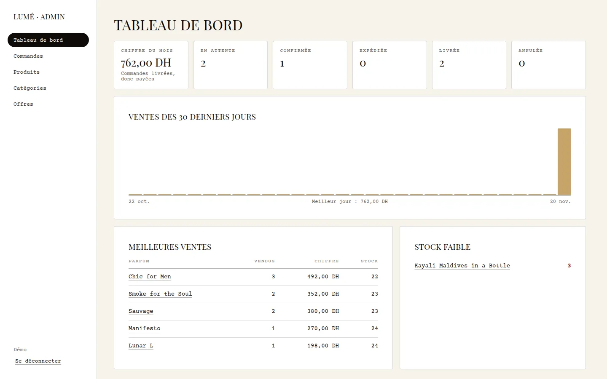
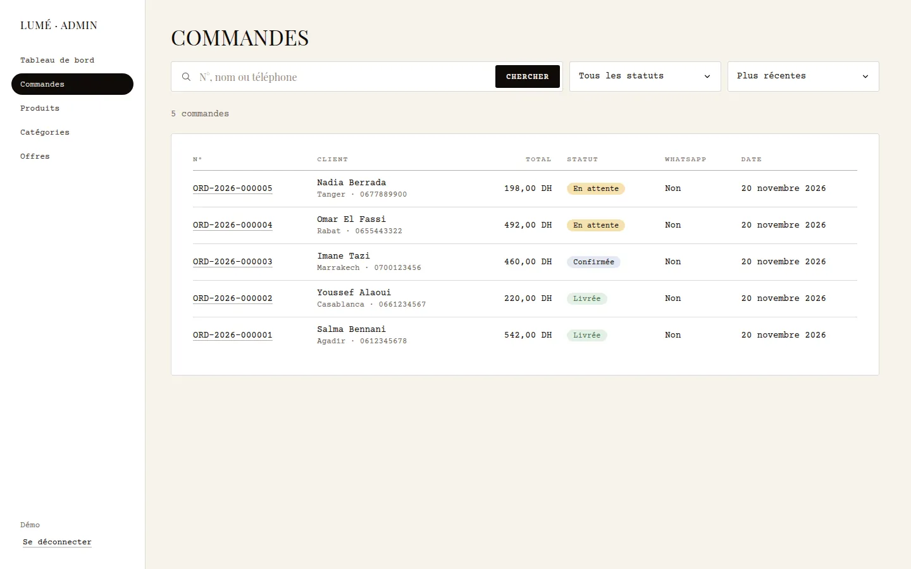
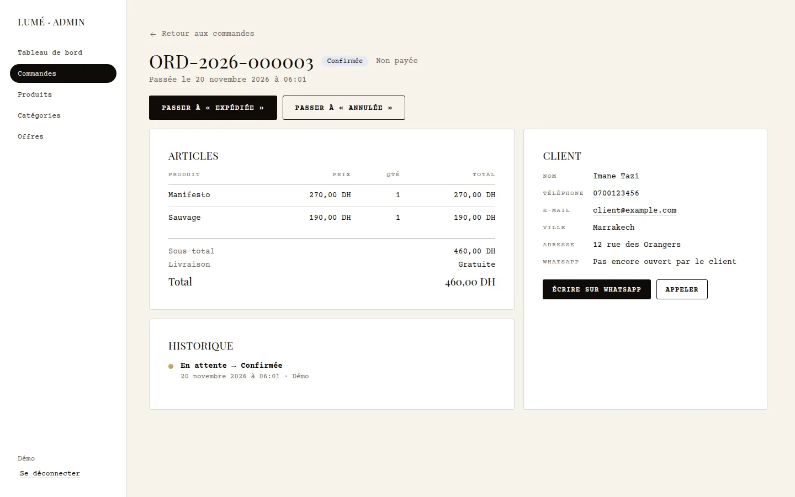
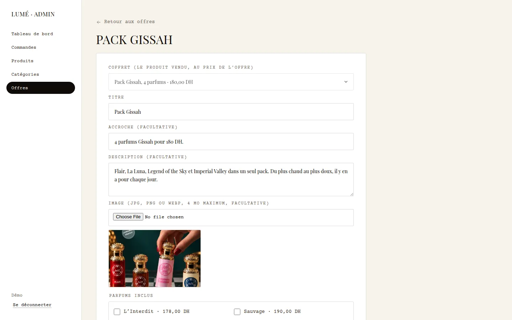
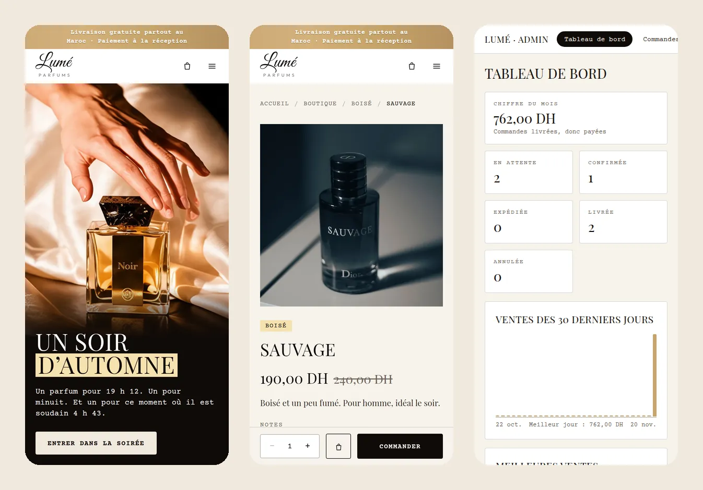

# Lumé Parfums

A full-stack online perfume shop for the Moroccan market, built as a portfolio project. Customers browse the catalog, order with cash on delivery and send their order through WhatsApp. The shop owner manages orders, products, categories and offers from an admin area.

The site is in French, prices are in Moroccan dirhams (DH), and it's designed for phones first.

**Live demo:** coming soon


> This is a demo shop. The prices and offers are invented and no order is ever delivered. The perfume names and photos belong to their brands.

## Features

**The shop**

- A catalog with search, category filters, a price range and sorting. The filters live in the address, so a filtered page can be shared.
- Product pages, and special offers sold as sets ("4 perfumes for 180 DH", "5 perfumes + 1 free").
- A bag kept in the browser, and a checkout with field-by-field errors from the server.
- After ordering, the customer sends a ready-made message on WhatsApp. The shop cancels an order if WhatsApp is never opened.
- Smooth scrolling and scroll-driven reveals (Lenis and GSAP) that respect "reduce motion".

**The admin area** (`/admin`)

- Login with a cookie session, and a forgotten-password flow by e-mail.
- A dashboard with the month's revenue, orders by status, a 30-day sales chart, best sellers and low stock.
- Orders: search by number, name or phone, filters, and status changes. Only the allowed moves are offered, and cancelling puts the stock back.
- Products, categories and offers: create, edit, hide and delete, with image upload.
- Loaded as a separate file, so shop visitors never download the admin's code.

**The API**

- A versioned REST API (`/api/v1`) with one response shape, French error messages and a request ID in every error.
- Orders are safe to retry (idempotency keys), lock stock rows in a fixed order to avoid deadlocks, and always take prices from the database.
- Catalog reads are cached, and the cache is cleared whenever an admin changes the catalog.
- E-mails for the customer and the shop, and scheduled jobs for payment reminders and automatic cancellation.
- 228 feature tests.

## Screenshots

| Shop | Product |
|---|---|
|  |  |
| **Offer** | **Checkout** |
|  |  |
| **Admin dashboard** | **Admin orders** |
|  |  |
| **One order** | **Editing an offer** |
|  |  |

On phones:



## Tech stack

| Part | Built with |
|---|---|
| Frontend | React 19, TypeScript 6, Vite 8, React Router 8, axios, GSAP and Lenis, plain CSS |
| Backend | PHP 8.3+, Laravel 13, Laravel Sanctum (cookie sessions and CSRF) |
| Database | MySQL or MariaDB, or SQLite |
| Tests and tools | PHPUnit, Laravel Pint, ESLint, the TypeScript compiler |

## How it's organised

```
backend/    The Laravel API: catalog, orders, admin, e-mails, scheduled jobs
frontend/   The React shop and admin area
docs/       The screenshots in this README
```

Each part has its own README with the details:

- [backend/README.md](backend/README.md): install, seed, run, tests, and how orders and offers work
- [backend/docs/API.md](backend/docs/API.md): every endpoint, with its fields and errors
- [frontend/README.md](frontend/README.md): run the shop, its pages and folders

## Run it on your computer

You need PHP 8.3 or newer, Composer, and Node.js 20.19 or newer.

**1. The backend**

```bash
cd backend
composer setup                 # installs, creates .env, the app key and an SQLite database
```

In `backend/.env`, fill in `SHOP_ADMIN_NAME`, `SHOP_ADMIN_EMAIL` and `SHOP_ADMIN_PASSWORD` (your admin account), then:

```bash
php artisan db:seed            # the demo catalog, its offers and your admin account
php artisan storage:link       # makes the product images reachable
php artisan serve              # the API on http://127.0.0.1:8000
```

**2. The frontend**, in a second terminal:

```bash
cd frontend
cp .env.example .env           # points the shop at http://127.0.0.1:8000
npm install
npm run dev -- --host 127.0.0.1
```

Open **http://127.0.0.1:5173**, and the admin at http://127.0.0.1:5173/admin. Use `127.0.0.1`, not `localhost`: the login and order cookies belong to `127.0.0.1`.

**Checks**

```bash
cd backend && php artisan test && vendor/bin/pint --test
cd frontend && npm run lint && npm run build
```

## Demo mode

The public demo runs with `SHOP_DEMO=true` on the backend and `VITE_DEMO_MODE=true` on the frontend. Every page then says it's a demo, the admin login page shows a demo account, and `php artisan shop:demo-reset` puts the fake catalog back at every start. The reset refuses to run outside demo mode. See "Demo mode" in [backend/README.md](backend/README.md).
